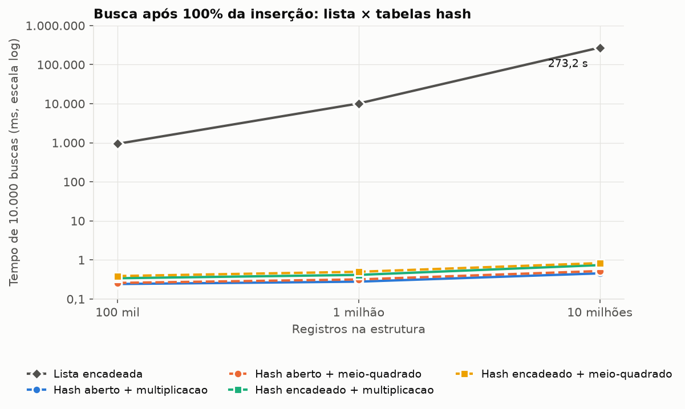
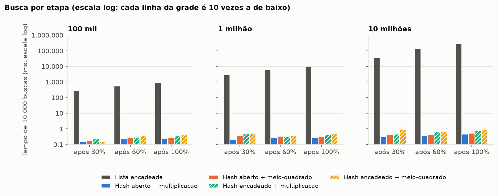
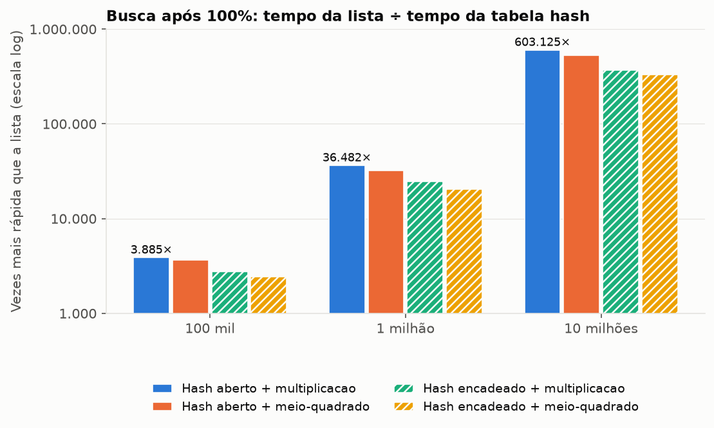
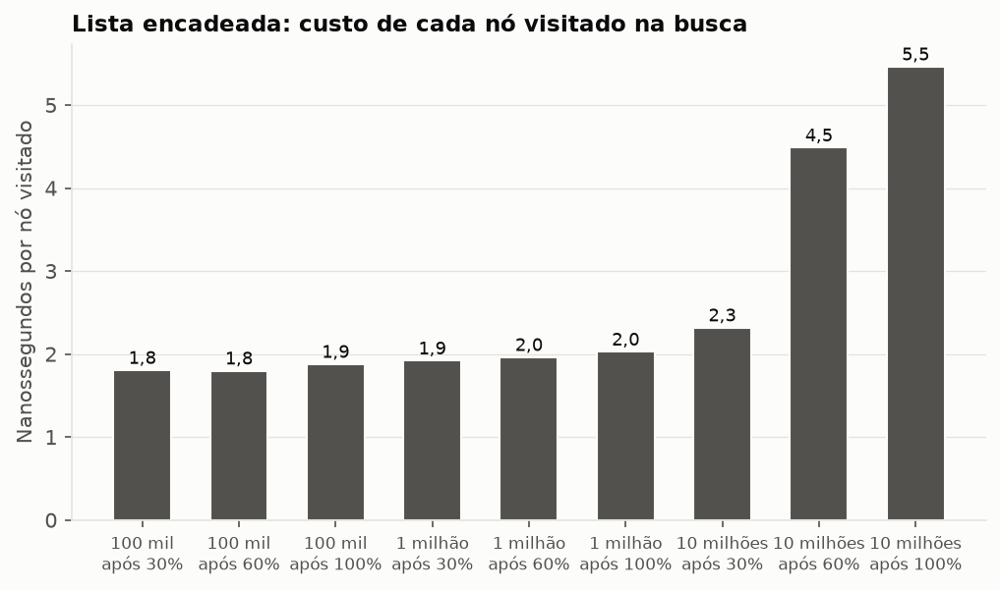
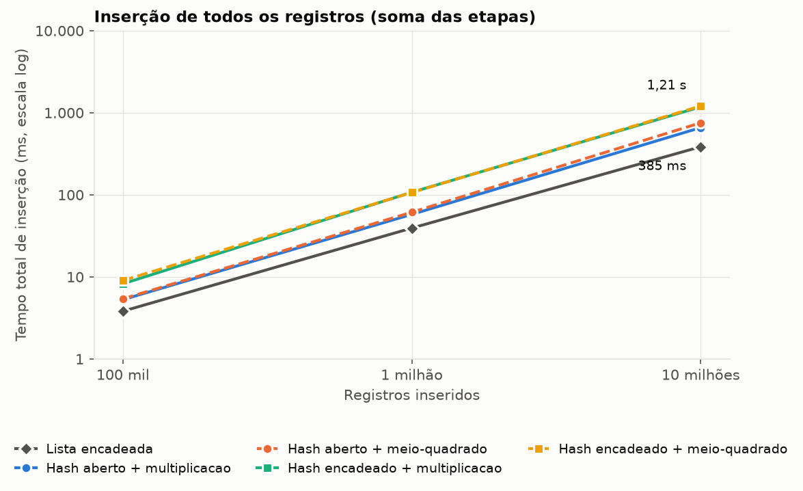
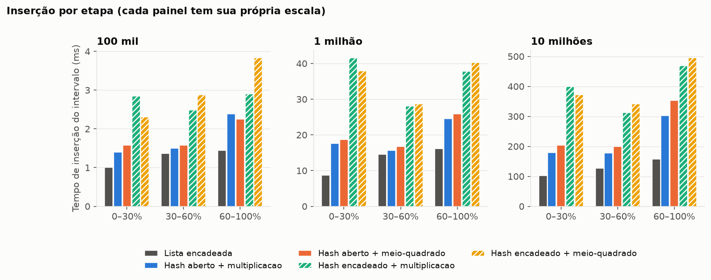
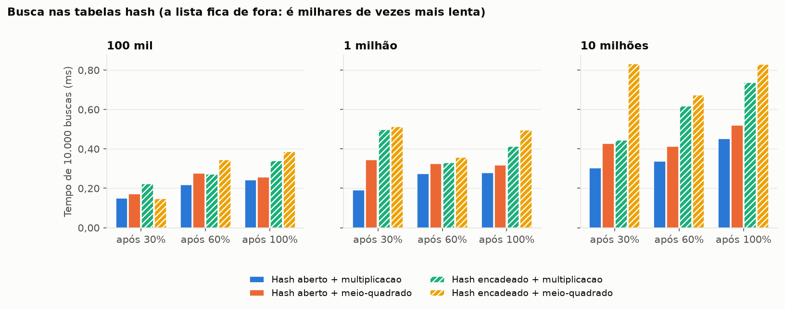
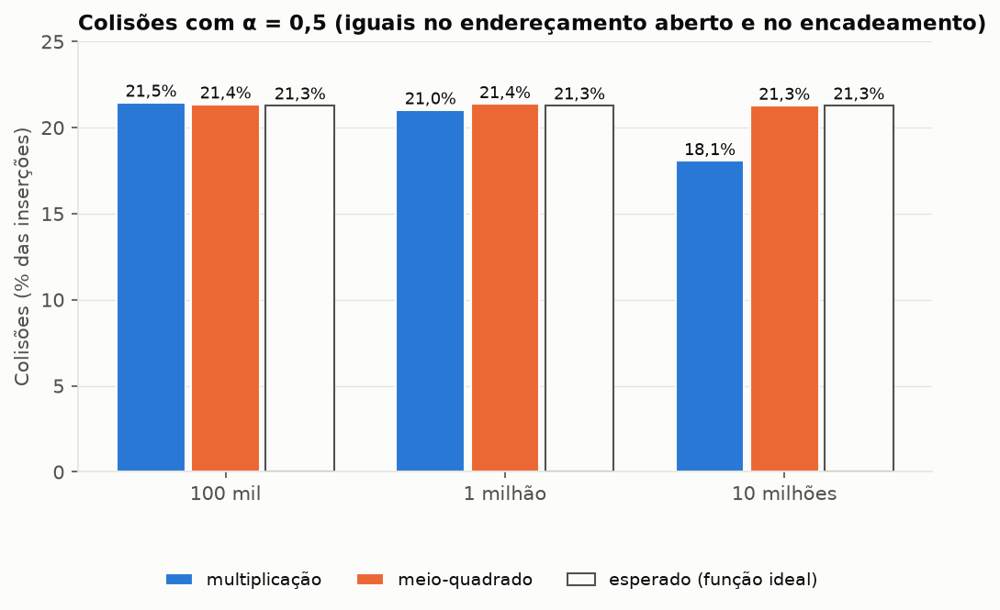

<h1>Estrutura de Dados Lineares — Comparação de Estruturas de Dados</h1>

<p align="center">
  
  
  
  
  
  
</p>

> Status do Projeto: :heavy_check_mark: (concluído) | :warning: (em desenvolvimento) | :x: (não iniciado)

---

# Tópicos

:small_blue_diamond: [Contexto](#contexto-information_source)

:small_blue_diamond: [Problema](#problema-writing_hand)

:small_blue_diamond: [Objetivo](#objetivo-dart)

:small_blue_diamond: [Estrutura do Projeto](#estrutura-do-projeto-file_folder)

:small_blue_diamond: [Pré-requisitos](#pré-requisitos-warning)

:small_blue_diamond: [Instalação](#instalação-rocket)

:small_blue_diamond: [Como Rodar o Projeto](#como-rodar-o-projeto-computer)

:small_blue_diamond: [Como o Experimento Funciona](#como-o-experimento-funciona-gear)

:small_blue_diamond: [Decisões de Projeto](#decisões-de-projeto-bulb)

:small_blue_diamond: [Resultados](#resultados-bar_chart)

:small_blue_diamond: [Análise dos Resultados](#análise-dos-resultados-chart_with_upwards_trend)

:small_blue_diamond: [Conclusão](#conclusão-checkered_flag)

:small_blue_diamond: [Tecnologias Utilizadas](#tecnologias-utilizadas-wrench)

:small_blue_diamond: [Documentação](#documentação-book)

:small_blue_diamond: [Referências](#referências-books)

:small_blue_diamond: [Desenvolvedores](#desenvolvedores-octocat)

---

# Contexto :information_source:

<p align="justify">
O projeto foi desenvolvido para a disciplina de <strong>Estrutura de Dados Lineares (INF1923)</strong>, do curso de <strong>Ciência da Computação da Universidade Católica de Pernambuco (UNICAP)</strong>, no semestre 2026.2, como Projeto do 2º GQ.
</p>

<p align="justify">
O trabalho implementa em C, como Tipos Abstratos de Dados, uma estrutura linear e quatro tabelas hash, e compara o desempenho delas nas operações de <strong>inserção</strong> e <strong>busca por matrícula</strong>, numa base de até 10 milhões de registros.
</p>

---

# Problema :writing_hand:

<p align="justify">
A base de dados é o Cadastro Nacional de Estudantes, com um registro por linha no formato <code>matricula;nome;curso</code>. É preciso guardar esses registros e encontrar um estudante pela matrícula, com volumes de <strong>100 mil</strong>, <strong>1 milhão</strong> e <strong>10 milhões</strong> de registros.
</p>

Foram comparadas cinco implementações:

| # | Estrutura | Tratamento de colisão | Função hash |
| --- | --- | --- | --- |
| 1 | Lista unicamente encadeada | (não se aplica) | (não se aplica) |
| 2 | Tabela hash | Endereçamento aberto, sondagem linear | Multiplicação |
| 3 | Tabela hash | Endereçamento aberto, sondagem linear | Meio-quadrado |
| 4 | Tabela hash | Encadeamento separado | Multiplicação |
| 5 | Tabela hash | Encadeamento separado | Meio-quadrado |

---

# Objetivo :dart:

<p align="justify">
O objetivo é medir e comparar o tempo de inserção e de busca das cinco implementações, o número de colisões e o fator de carga das tabelas hash, e explicar as diferenças com base na complexidade de cada estrutura, nas estratégias de tratamento de colisão e nas funções hash.
</p>

<p align="justify">
Além dos resultados, o trabalho justifica as escolhas de projeto: o tamanho da tabela, o tipo de sondagem, as funções hash, a forma de contar colisões e a remoção nas tabelas hash.
</p>

---

# Estrutura do Projeto :file_folder:

<p align="justify">
Cada estrutura é um Tipo Abstrato de Dados: um <code>.h</code> com o tipo opaco (<code>typedef struct x* X</code>) e as operações, e um <code>.c</code> com a implementação. Toda a memória é alocada dinamicamente.
</p>

```
comparacao_de_estruturas_de_dados/
├── data/                      base de dados (alunos.txt)
├── doc/
│   ├── Comparacao_de_Estruturas_de_Dados_Projeto_2_GQ.pptx   slides da apresentação
│   └── Projeto 2GQ.pdf        orientações do projeto (professor)
├── resultados/                resultados da execução descrita em "Resultados"
│   ├── resultados.csv         medições (gerado pelo programa)
│   ├── resultados.md          as mesmas medições em tabelas, etapa por etapa
│   ├── saida_console.txt      cópia da saída da tela (gerado pelo programa)
│   └── graficos/              gráficos (gerados pelo script)
├── scripts/
│   └── gerar_graficos.py      gera os gráficos comparativos a partir do CSV
├── src/
│   ├── lista/                 lista unicamente encadeada
│   │   ├── lista.h
│   │   └── lista.c
│   ├── hash_aberto/           tabela hash com endereçamento aberto
│   │   ├── hash_aberto.h
│   │   └── hash_aberto.c
│   ├── hash_encadeado/        tabela hash com encadeamento separado
│   │   ├── hash_encadeado.h
│   │   └── hash_encadeado.c
│   ├── utils/                 módulos de apoio, usados pelas estruturas e pelo main
│   │   ├── aluno.h
│   │   ├── aluno.c
│   │   ├── funcoes_hash.h
│   │   ├── funcoes_hash.c
│   │   ├── leitura.h
│   │   ├── leitura.c
│   │   ├── saida.h
│   │   └── saida.c
│   └── main.c                 experimentos
├── LICENSE
└── README.md
```


Cada estrutura tem sua pasta em `src/`. Os módulos de apoio ficam em `src/utils/`, e as pastas das estruturas os incluem com `#include "../utils/aluno.h"`. O `main.c` fica na raiz de `src/` e inclui tudo pelo caminho da pasta, como `#include "lista/lista.h"`.

| Módulo | Conteúdo |
| --- | --- |
| `src/lista/` | TAD `Lista`: lista unicamente encadeada com nó descritor (`inicio`, `qtd`) |
| `src/hash_aberto/` | TAD `HashAberto`: endereçamento aberto com sondagem linear |
| `src/hash_encadeado/` | TAD `HashEncadeado`: encadeamento separado |
| `src/utils/aluno.h/.c` | TAD `Aluno`: matrícula, nome e curso |
| `src/utils/funcoes_hash.h/.c` | Métodos da multiplicação e do meio-quadrado; `proximo_primo` |
| `src/utils/leitura.h/.c` | Leitura do arquivo na ordem original |
| `src/utils/saida.h/.c` | `escrever`: igual ao `printf`, mas escreve na tela e em `resultados/saida_console.txt` |
| `src/main.c` | Experimentos: etapas, medições e arquivo de resultados |

Convenção de retorno: as funções de inserção devolvem **1 = sucesso, 0 = falha** (como no `1_tabela_hash.c` da disciplina). As buscas devolvem o `Aluno` encontrado ou `NULL`.


---

# Pré-requisitos :warning:

Antes de clonar o repositório e executar o projeto, é necessário ter:

**1. Compilador C (gcc):**
  - No Windows, instale o MinGW-w64: https://www.mingw-w64.org/downloads/
  - No Linux, instale o pacote `gcc` (por exemplo, `sudo apt install gcc`); no macOS, as ferramentas de linha de comando do Xcode (`xcode-select --install`).

**2. Git:**
  - Caso não tenha Git, instale: https://git-scm.com/install/

**3. Python 3.x com matplotlib (só para gerar os gráficos):**
  - Caso não tenha Python, instale: https://www.python.org/downloads/

**4. Base de dados `alunos.txt`:**
  - Disponível no Teams da disciplina. Ela não vai para o repositório: tem mais de 300 MB, e o GitHub recusa arquivos acima de 100 MB.

**5. Memória:**
  - Com 10 milhões de registros, o programa ocupa cerca de 3,3 GB de RAM. Feche outros programas antes de rodar.

---

# Instalação :rocket:

### 1️⃣ Clonar o repositório

```bash
git clone https://github.com/the-compilers-organization/comparacao_de_estruturas_de_dados.git
```

---

### 2️⃣ Entrar na pasta do projeto

```bash
cd comparacao_de_estruturas_de_dados
```

---

### 3️⃣ Colocar a base de dados

Salve o arquivo baixado do Teams como **`data/alunos.txt`**. O `.gitignore` envia só a pasta `data/` vazia (com um `.gitkeep`).

---

### 4️⃣ Instalar o matplotlib (para os gráficos)

```bash
pip install matplotlib
```

---

# Como Rodar o Projeto :computer:

Os comandos abaixo são executados **na pasta raiz do projeto** (onde está o `README.md`).

### 1️⃣ Compilar

O mesmo comando no Linux, no macOS e no Windows; no Windows, troque `-o projeto` por `-o projeto.exe`:

```bash
gcc -Wall -Wextra -O2 -std=c99 src/main.c src/utils/aluno.c src/utils/leitura.c src/utils/saida.c src/utils/funcoes_hash.c src/lista/lista.c src/hash_aberto/hash_aberto.c src/hash_encadeado/hash_encadeado.c -o projeto
```

O comando lista todos os `.c` do projeto: os da raiz de `src/` e um de cada pasta de estrutura. Os `.h` não entram no comando, porque são incluídos pelos próprios `.c` com `#include`.

---

### 2️⃣ Executar

```bash
./projeto          # no Windows: projeto.exe
```

O programa lê `data/alunos.txt`, roda os volumes de 100 mil, 1 milhão e 10 milhões e grava dois arquivos em `resultados/`:

- **`resultados.csv`**: uma linha por estrutura e etapa, com tempos, matrículas encontradas, colisões e fator de carga;
- **`saida_console.txt`**: tudo o que apareceu na tela, gravado automaticamente, sem copiar e colar do terminal. O arquivo é gravado linha a linha: se o programa for interrompido no meio, o que já saiu na tela fica salvo.

> Os dois arquivos são recriados a cada execução. Os arquivos que vêm no repositório são os da execução descrita em [Resultados](#resultados-bar_chart). Ao rodar o programa e o script de gráficos, eles são substituídos pelos resultados novos.

---

### 3️⃣ Gerar os gráficos

Depois de executar o programa, também a partir da pasta raiz:

```bash
python scripts/gerar_graficos.py          # no Linux/macOS, pode ser python3
```

O script lê `resultados/resultados.csv` e grava oito gráficos PNG em `resultados/graficos/`:

| Arquivo | O que mostra |
| --- | --- |
| `1_busca_por_volume.png` | Tempo das 10.000 buscas após 100%, por volume, nas cinco estruturas (escala log) |
| `2_busca_hash_por_etapa.png` | Busca nas quatro tabelas hash, por etapa, um painel por volume |
| `3_insercao_por_etapa.png` | Tempo de inserção de cada intervalo, nas cinco estruturas |
| `4_vezes_mais_rapido_que_lista.png` | Quantas vezes cada tabela hash foi mais rápida que a lista na busca |
| `5_colisoes_vs_esperado.png` | Colisões de cada função (% das inserções) contra uma função ideal |
| `6_lista_custo_por_no.png` | Nanossegundos por nó visitado na busca da lista (efeito da memória cache) |
| `7_busca_por_etapa.png` | Tempo das 10.000 buscas de cada etapa, nas cinco estruturas, um painel por volume (escala log) |
| `8_insercao_por_volume.png` | Tempo total para inserir todos os registros (soma das três etapas), por volume, nas cinco estruturas (escala log) |

Para outro CSV, passe o arquivo e a pasta de saída: `python scripts/gerar_graficos.py outro.csv outra_pasta`. As cores de cada estrutura são as mesmas em todos os gráficos, e o encadeamento separado aparece com hachura. No Windows, buscas abaixo de 1 ms podem ser medidas como 0 (veja *Medição com `clock()`*); essas barras ficam de fora, e o gráfico avisa numa nota.

---

### Outras opções

**Outros volumes:** altere o vetor no início do `main`, em `src/main.c`:

```c
int volumes[3] = {100000, 1000000, 10000000};
```

Se o arquivo tiver menos registros que um volume, aquele volume é pulado com um aviso. Linhas incompletas são ignoradas e contadas.

**No VS Code:** a tarefa "Compilar C/C++" compila só os `.c` da pasta do arquivo aberto, e por isso não serve para este projeto, que tem pastas separadas. Use a tarefa **"Compilar projeto"** (Terminal → Executar Tarefa) e a configuração de execução **"Executar projeto"**: as duas trabalham a partir da pasta raiz, onde o programa encontra `data/alunos.txt`. A tarefa precisa listar os mesmos `.c` do comando acima, incluindo `src/utils/saida.c`.

**Memória:** com 10 milhões de registros, os registros e as cinco estruturas juntos ocupam cerca de 3,3 GB de RAM (cada aluno ocupa 104 bytes com `TAM 50`, e cada posição do endereçamento aberto, 16 bytes).

**Tempo:** a lista encadeada domina o tempo total, porque cada uma das 10.000 buscas percorre, em média, metade da lista. No ambiente de teste, a execução completa (100 mil, 1 milhão e 10 milhões) levou 8 minutos, quase todos (7 min 43 s) em buscas na lista. Num computador mais lento ou com menos memória livre, pode levar bem mais.

---

# Como o Experimento Funciona :gear:

Para cada volume (100 mil, 1 milhão e 10 milhões):

1. **Tamanho da tabela:** `m = proximo_primo(2 × volume)`, ou seja 200.003, 2.000.003 e 20.000.003. É o mesmo nas quatro tabelas hash e fica fixo durante o experimento.
2. **Cinco estruturas vazias** são criadas.
3. **Três etapas de inserção**, preservando a ordem do arquivo: registros de 0 a 30%, de 30% a 60% e de 60% a 100%. O tempo de cada intervalo é medido separadamente, para cada estrutura.
4. **Após cada etapa:** 10.000 matrículas são sorteadas entre os registros já inseridos. As **mesmas** matrículas, na **mesma** ordem, são buscadas nas cinco estruturas, e o programa confere se todas foram encontradas.
5. **Métricas das tabelas hash, por etapa:** colisões no intervalo e fator de carga α = n/m.

Ficam **fora** das medições de tempo a leitura do arquivo e o sorteio das matrículas.

---

# Decisões de Projeto :bulb:

### 1. Lista unicamente encadeada com inserção no início

A lista tem nó descritor com `inicio` e `qtd`, como nas aulas. A inserção é feita no **início**, em O(1). Inserir no final custaria O(n) por inserção, porque o descritor não guarda o último nó, e O(n²) para carregar a base inteira: com 10 milhões de registros, seriam cerca de 5 × 10¹³ passos. Isso não muda o resultado da busca, que é sequencial e O(n) em qualquer caso.

A base não tem matrículas repetidas (verificamos isso no arquivo), por isso a inserção não procura duplicatas. Procurar duplicatas tornaria a inserção na lista O(n).

### 2. Tamanho da tabela: primo ≥ 2 × volume (α final = 0,5)

- **Por que um primo:** é a recomendação vista em sala para quebrar padrões aritméticos das chaves. No meio-quadrado, o resto da divisão por `m` é a etapa final, então o primo também ajuda ali.
- **Por que 2 × volume:** no endereçamento aberto, o número de posições testadas por busca depende principalmente da fração da tabela ocupada e cresce muito quando a tabela se aproxima de cheia. Isso foi observado já no trabalho que introduziu o endereçamento aberto (PETERSON, 1957). Pela análise clássica da sondagem linear (KNUTH, 1998), com α = 0,5 uma busca bem-sucedida testa em média ½(1 + 1/(1 − α)) = **1,5** posições, e uma inserção testa ½(1 + 1/(1 − α)²) = **2,5**. Com α = 0,9, esses valores sobem para 5,5 e 50,5.
- **Por que não maior:** Richter, Alvarez e Dittrich (2015) mostram que a sondagem linear é a melhor opção abaixo de 50% de ocupação quando a maioria das buscas encontra a chave, como no nosso caso, em que todas encontram. Acima de 60%, ela passa a sofrer com agrupamento primário. Uma tabela maior gastaria mais memória sem ganho relevante.
- **No encadeamento separado**, o mesmo `m` dá listas com 0,5 elemento em média, e a busca custa Θ(1 + α) (CORMEN et al., 2009).

### 3. Endereçamento aberto com sondagem linear

Das três sondagens vistas em sala, a linear é a mais simples e a de melhor localidade de memória: as posições testadas são vizinhas, então ficam na mesma linha de cache. Richter, Alvarez e Dittrich (2015) a apontam como a mais rápida em inserções com fator de carga baixo. O ponto fraco é o agrupamento primário: Heileman e Luo (2005) mostram que o desempenho da sondagem linear varia muito com a qualidade da função hash e pode ficar muito pior que o do duplo hash no pior caso. Por isso mantivemos α ≤ 0,5.

### 4. Primeira função: método da multiplicação

`h(k) = ⌊ m × frac(k × A) ⌋`, com A = (√5 − 1)/2 ≈ 0,6180339887, a constante sugerida por Knuth (1998). Richter, Alvarez e Dittrich (2015) mostram que o hashing multiplicativo é barato (uma multiplicação) e tem boa qualidade para chaves inteiras, mas com mais variação entre distribuições de dados que funções mais elaboradas.

**Usamos `double`, não `float`.** Um `float` tem 24 bits de mantissa: para uma matrícula de 8 dígitos, `k × A` passa de 2²⁴ ≈ 16,7 milhões e o `float` não guarda mais casas decimais. Testamos: com `float`, a parte fracionária de 86694336 × A dá 0, e **todas** as matrículas grandes cairiam no índice 0. Com `double` (53 bits), a precisão é suficiente para tabelas de 20 milhões de posições.

### 5. Segunda função: método do meio-quadrado (mid-square)

1. Eleva a matrícula ao quadrado em `long long`. 99.999.999² tem 16 dígitos e não cabe em `int` (máximo 2.147.483.647): com `int`, a conta estoura e o índice sai errado ou até negativo. Testamos: a matrícula 86694336 daria o índice −140.567, fora da tabela.
2. Descarta os 4 dígitos da direita.
3. Pega os dígitos seguintes com `% m`.

O resultado é formado pelos **dígitos do meio** do quadrado, que dependem de todos os dígitos da chave. Os da direita dependem só dos últimos dígitos da chave. É um dos métodos clássicos de transformação de chave em endereço, descrito no levantamento de Maurer e Lewis (1975) e comparado com outros cinco métodos em arquivos reais grandes por Lum, Yuen e Dodd (1971). Escolhemos esse método porque usa só operações vistas no curso (multiplicação, divisão inteira e resto) e é diferente da multiplicação por uma constante.

### 6. Remoção nas tabelas hash

O enunciado mede só inserção e busca, mas as duas tabelas hash também têm remoção. A forma de remover depende da estratégia de colisão.

**Endereçamento aberto: estado `REMOVIDO`** (`remover_hash_aberto`, slides 40 a 43). Cada posição do vetor é uma `struct item` com três campos: `chave` (a matrícula), `estado` e `aluno` (ponteiro para o registro). O estado é um de três valores, definidos com `#define`:

| Estado | Significado | O que a busca faz |
| --- | --- | --- |
| `VAZIO` | a posição nunca foi usada | para: a matrícula não existe |
| `OCUPADO` | guarda um aluno | compara a chave; se for diferente, continua |
| `REMOVIDO` | havia um aluno, mas ele foi removido | continua sondando |

Ao remover, a posição **não volta a ser `VAZIO`**: ela passa a `REMOVIDO`. Se voltasse a ser `VAZIO`, a busca pararia ali e diria que não existem as matrículas que colidiram e foram guardadas depois, como A no slide 43. Na inserção, uma posição `REMOVIDO` é reutilizada, como na rotina de inserção de Cormen et al. (2009, seção 11.4). Sem isso, as posições removidas nunca mais seriam usadas. A tabela é criada com todos os estados em `VAZIO`.

**Encadeamento separado: desencadear e liberar o nó** (`remover_hash_encadeado`, slides 51 a 53). Não há marca. O ponteiro `atual` percorre a lista da posição, e `anterior` acompanha o nó de trás. Ao achar a matrícula, a lista é refeita **antes** do `free(atual)`:

- se o nó é o primeiro da lista, o vetor passa a apontar para o seguinte (`ha->tabela[pos] = atual->prox`);
- senão, o anterior pula o nó removido (`anterior->prox = atual->prox`).

| Aspecto | Endereçamento aberto | Encadeamento separado |
| --- | --- | --- |
| Onde ficam os elementos | No próprio vetor | Em listas, uma por posição |
| Como remove | Estado vira `REMOVIDO` | Desencadeia e libera o nó |
| Busca após a remoção | Continua sondando após `REMOVIDO` | Percorre o restante da lista |
| Custo esperado | O(1), com boa dispersão | O(1), com boa dispersão |
| Pior caso | O(n) | O(n) |

Nos dois casos, só a posição ou o nó são liberados. O `Aluno` não é liberado, porque pertence ao vetor criado na leitura.

### 7. Contagem de colisões

Seguimos a definição do enunciado: conta-se uma colisão quando uma nova matrícula produz um **índice inicial** que já foi produzido por outra.

- **Endereçamento aberto:** um vetor `ja_usado[m]` marca os índices iniciais já produzidos. Não basta olhar se a posição está ocupada, porque ela pode estar ocupada por um elemento deslocado de outra posição pela sondagem.
- **Encadeamento:** como não há remoções, a lista da posição não estar vazia significa exatamente que o índice já foi produzido.

Como as duas estratégias usam a mesma função para o índice inicial, **a mesma função dá o mesmo número de colisões nas duas estratégias**. Isso serve de verificação de que a contagem está correta. A diferença de desempenho entre as estratégias aparece nos tempos.

Para comparação, se a função espalhasse as chaves de forma perfeitamente aleatória, o número esperado de colisões após inserir n chaves seria n − m(1 − (1 − 1/m)ⁿ). Com α = 0,5, isso dá cerca de 21% das inserções.

### 8. Outras decisões

- **As estruturas guardam a matrícula e um ponteiro para `Aluno`.** Cada registro é criado uma vez na leitura, e as cinco estruturas apontam para ele, sem copiar 10 milhões de registros cinco vezes. A matrícula também fica no próprio nó ou item (`chave`), como na `struct elem` vista em aula. Assim a busca compara a chave direto, sem ir até o registro a cada passo, e as cinco estruturas comparam do mesmo jeito. O nó continua com 32 bytes na memória, por isso esse campo não aumenta o consumo.
- **Medição com `clock()`**, de `time.h`. No Linux a resolução é de microssegundos. No Windows ela é de cerca de 1 ms, por isso tempos muito curtos (buscas nas tabelas hash com 100 mil registros) podem aparecer como 0 ou 1 ms.
- **Sorteio com `rand()`** e semente fixa (`srand(2026)`), para o sorteio se repetir a cada execução. No Windows, o `rand()` só vai até 32.767 e não alcançaria posições na casa dos milhões, então a função `sortear` junta dois sorteios: `(rand() % 32768) * 32768 + rand() % 32768`, que vai até cerca de 1 bilhão.
- **Tipos inteiros:** o projeto usa `int` em tudo, exceto no quadrado do meio-quadrado (`long long`), que não cabe em `int`. Os contadores de colisões cabem em `int`: com 10 milhões de registros, ficam na casa do milhão, e o limite do `int` é 2,1 bilhões.
- **Saída gravada em arquivo (`saida.h/.c`):** em vez de `printf`, o programa usa `escrever`, que recebe os mesmos argumentos e escreve na tela e em `resultados/saida_console.txt`. Para repassar os argumentos variáveis (`...`) ao `vprintf` e ao `vfprintf`, a função usa `va_list`, de `stdarg.h`, a única parte do projeto além do conteúdo da disciplina. Depois de cada escrita, `fflush` grava o texto no arquivo na hora, para nada se perder se o programa for interrompido. O arquivo fica aberto do início ao fim da execução, e só o módulo `saida.c` acessa o ponteiro dele (`static`).
- **Código simples:** fora o `stdarg.h` do item anterior, o projeto usa só recursos de programação estruturada em C (`struct`, ponteiros, `malloc`/`free`, `if`, `for`, `while` e funções). Cada estrutura tem funções separadas e curtas, e o `main.c` testa as cinco estruturas uma depois da outra, sem truques.

---

# Resultados :bar_chart:

Os resultados abaixo foram obtidos num ambiente de teste (Linux em nuvem, processador Intel Xeon 2,1 GHz, 2 núcleos, 8 GB de RAM, `gcc 13.3 -O2`), com a base completa de 10 milhões de registros. A execução inteira levou 8 minutos, e o programa ocupou cerca de 3,3 GB de RAM no volume de 10 milhões.

Arquivos completos: [`resultados/resultados.csv`](resultados/resultados.csv), [`resultados/resultados.md`](resultados/resultados.md) (as mesmas medições, etapa por etapa), [`resultados/saida_console.txt`](resultados/saida_console.txt) (saída da tela) e os gráficos em [`resultados/graficos/`](resultados/graficos/). Em outra máquina os tempos serão diferentes, principalmente no Windows, onde o `clock()` mede de 1 em 1 ms e as buscas nas tabelas hash aparecem como 0 ou 1 ms. As colisões e o fator de carga são iguais em qualquer máquina. Em todas as etapas, as cinco estruturas encontraram as 10.000 matrículas buscadas.

### 100.000 registros (TABLE_SIZE = 200.003)

Tempos em milissegundos. Inserção = tempo do intervalo; busca = 10.000 buscas após a etapa.

| Estrutura | Inserção 0–30% | Inserção 30–60% | Inserção 60–100% | Busca 30% | Busca 60% | Busca 100% |
| --- | ---: | ---: | ---: | ---: | ---: | ---: |
| Lista encadeada | 1,01 | 1,37 | 1,45 | 271,09 | 540,17 | 940,08 |
| Hash aberto + multiplicacao | 1,40 | 1,50 | 2,39 | 0,15 | 0,22 | 0,24 |
| Hash aberto + meio-quadrado | 1,57 | 1,58 | 2,25 | 0,17 | 0,28 | 0,26 |
| Hash encadeado + multiplicacao | 2,84 | 2,49 | 2,90 | 0,22 | 0,27 | 0,34 |
| Hash encadeado + meio-quadrado | 2,30 | 2,88 | 3,84 | 0,15 | 0,35 | 0,39 |

| Tabela hash | Colisões 0–30% | Colisões 30–60% | Colisões 60–100% | Colisões (total) | α após 30% / 60% / 100% |
| --- | ---: | ---: | ---: | ---: | ---: |
| Hash aberto + multiplicacao | 2.176 | 6.073 | 13.215 | 21.464 | 0,15 / 0,30 / 0,50 |
| Hash aberto + meio-quadrado | 2.150 | 6.011 | 13.199 | 21.360 | 0,15 / 0,30 / 0,50 |
| Hash encadeado + multiplicacao | 2.176 | 6.073 | 13.215 | 21.464 | 0,15 / 0,30 / 0,50 |
| Hash encadeado + meio-quadrado | 2.150 | 6.011 | 13.199 | 21.360 | 0,15 / 0,30 / 0,50 |

### 1.000.000 registros (TABLE_SIZE = 2.000.003)

Tempos em milissegundos. Inserção = tempo do intervalo; busca = 10.000 buscas após a etapa.

| Estrutura | Inserção 0–30% | Inserção 30–60% | Inserção 60–100% | Busca 30% | Busca 60% | Busca 100% |
| --- | ---: | ---: | ---: | ---: | ---: | ---: |
| Lista encadeada | 8,66 | 14,59 | 16,08 | 2.882 | 5.890 | 10.142 |
| Hash aberto + multiplicacao | 17,64 | 15,60 | 24,54 | 0,19 | 0,28 | 0,28 |
| Hash aberto + meio-quadrado | 18,73 | 16,75 | 25,87 | 0,34 | 0,33 | 0,32 |
| Hash encadeado + multiplicacao | 41,63 | 28,02 | 37,84 | 0,50 | 0,33 | 0,41 |
| Hash encadeado + meio-quadrado | 37,89 | 28,68 | 40,20 | 0,51 | 0,36 | 0,50 |

| Tabela hash | Colisões 0–30% | Colisões 30–60% | Colisões 60–100% | Colisões (total) | α após 30% / 60% / 100% |
| --- | ---: | ---: | ---: | ---: | ---: |
| Hash aberto + multiplicacao | 20.941 | 59.356 | 129.980 | 210.277 | 0,15 / 0,30 / 0,50 |
| Hash aberto + meio-quadrado | 21.567 | 60.371 | 131.855 | 213.793 | 0,15 / 0,30 / 0,50 |
| Hash encadeado + multiplicacao | 20.941 | 59.356 | 129.980 | 210.277 | 0,15 / 0,30 / 0,50 |
| Hash encadeado + meio-quadrado | 21.567 | 60.371 | 131.855 | 213.793 | 0,15 / 0,30 / 0,50 |

### 10.000.000 registros (TABLE_SIZE = 20.000.003)

Tempos em milissegundos. Inserção = tempo do intervalo; busca = 10.000 buscas após a etapa.

| Estrutura | Inserção 0–30% | Inserção 30–60% | Inserção 60–100% | Busca 30% | Busca 60% | Busca 100% |
| --- | ---: | ---: | ---: | ---: | ---: | ---: |
| Lista encadeada | 101,79 | 126,50 | 156,95 | 34.800 | 134.635 | 273.216 |
| Hash aberto + multiplicacao | 179,81 | 177,11 | 301,92 | 0,30 | 0,34 | 0,45 |
| Hash aberto + meio-quadrado | 203,14 | 198,75 | 352,45 | 0,43 | 0,41 | 0,52 |
| Hash encadeado + multiplicacao | 399,45 | 312,55 | 468,72 | 0,45 | 0,62 | 0,74 |
| Hash encadeado + meio-quadrado | 372,41 | 341,13 | 495,87 | 0,83 | 0,67 | 0,83 |

| Tabela hash | Colisões 0–30% | Colisões 30–60% | Colisões 60–100% | Colisões (total) | α após 30% / 60% / 100% |
| --- | ---: | ---: | ---: | ---: | ---: |
| Hash aberto + multiplicacao | 174.126 | 502.503 | 1.130.579 | 1.807.208 | 0,15 / 0,30 / 0,50 |
| Hash aberto + meio-quadrado | 214.004 | 601.224 | 1.313.439 | 2.128.667 | 0,15 / 0,30 / 0,50 |
| Hash encadeado + multiplicacao | 174.126 | 502.503 | 1.130.579 | 1.807.208 | 0,15 / 0,30 / 0,50 |
| Hash encadeado + meio-quadrado | 214.004 | 601.224 | 1.313.439 | 2.128.667 | 0,15 / 0,30 / 0,50 |

---

# Análise dos Resultados :chart_with_upwards_trend:

### 1. Busca: as tabelas hash são centenas de milhares de vezes mais rápidas que a lista







Com 10 milhões de registros, as 10.000 buscas da última etapa levaram **273 segundos** (4,5 minutos) na lista e **menos de 1 milissegundo** em qualquer tabela hash (de 0,45 ms a 0,83 ms), uma diferença de 330 mil a 600 mil vezes. A lista faz busca sequencial, O(n): cada busca percorre em média metade dos nós. A tabela hash calcula a posição e testa, em média, 1 a 2 posições, O(1) no caso médio.

O tempo da lista também cresce **mais rápido que n**. De 100 mil para 10 milhões de registros (100 vezes mais dados), a busca ficou 291 vezes mais lenta. O custo por nó visitado subiu de 1,9 ns (100 mil) e 2,0 ns (1 milhão) para 5,5 ns (10 milhões), porque a lista grande não cabe na memória cache do processador, e os nós passam a vir da memória RAM. O salto aparece já dentro do volume de 10 milhões: da etapa de 30% para a de 60% a lista dobra de tamanho, mas a busca fica 3,9 vezes mais lenta (de 34,8 s para 134,6 s).



Nas tabelas hash, o tempo de busca fica abaixo de 1 ms em todos os volumes (0,24 ms, 0,28 ms e 0,45 ms no endereçamento aberto com multiplicação, após 100%), como prevê o custo O(1).

O acesso à memória pesa muito nesse resultado. Numa versão anterior do projeto, o nó guardava só o ponteiro para o `Aluno`, e a busca precisava ir até o registro para ler a matrícula a cada nó. Com 1 milhão de registros, a busca na lista levava 30,5 s. Guardando a matrícula no próprio nó, caiu para cerca de 10 s (10,1 s nesta execução), sem mudar a complexidade, que continua O(n).

### 2. Inserção: a lista é a mais rápida, e o encadeamento é o mais lento





A inserção no início da lista é O(1) e só faz um `malloc` e algumas atribuições, por isso foi a mais rápida em todas as etapas dos três volumes. Com 100 mil, porém, todos os tempos ficam entre 1 e 4 ms e as diferenças são pequenas. O endereçamento aberto vem em seguida: calcula o hash e preenche um item de um vetor já alocado. O encadeamento separado é o mais lento para inserir, em geral de 1,5 a 2 vezes o tempo do endereçamento aberto (de 1,2 a 2,4 vezes, conforme a etapa), porque faz um `malloc` por elemento. Isso concorda com Richter, Alvarez e Dittrich (2015), que recomendam evitar o encadeamento em cargas com muitas escritas.

### 3. Endereçamento aberto contra encadeamento separado



Com o mesmo fator de carga (α = 0,5), o endereçamento aberto também foi mais rápido na busca após a última etapa, nos três volumes e com as duas funções (com 10 milhões e multiplicação, 0,45 ms contra 0,74 ms; com 1 milhão, 0,28 ms contra 0,41 ms). Com tempos abaixo de 1 ms, pequenas diferenças se confundem com a variação da medição, e numa etapa intermediária (100 mil, após 30%, meio-quadrado) o encadeamento foi um pouco mais rápido. Ele compara a matrícula direto no vetor, e as posições vizinhas da sondagem linear ficam na mesma linha de cache. No encadeamento, cada elemento está num nó alocado separadamente, e é preciso seguir um ponteiro a mais até ele.

Com α ≤ 0,5, o agrupamento primário da sondagem linear fica sob controle: pela análise clássica (KNUTH, 1998), uma busca bem-sucedida testa em média 1,5 posições. Com uma tabela mais cheia, esse número cresceria rapidamente, como observaram Peterson (1957) e Heileman e Luo (2005).

### 4. Multiplicação contra meio-quadrado

As duas funções espalharam bem as matrículas.



- **Meio-quadrado:** as colisões ficaram praticamente iguais às esperadas para uma função ideal, que espalhasse as chaves ao acaso, nos três volumes: com 10 milhões, 2.128.667 contra 2.130.613 esperadas, cerca de 21,3% das inserções.
- **Multiplicação:** ficou perto do esperado com 100 mil e 1 milhão de registros (+0,7% e −1,3%), e **15% abaixo** com 10 milhões (1.807.208 colisões, 18,1% das inserções). Os valores de frac(k × A) com A = (√5 − 1)/2 ficam bem distribuídos entre 0 e 1 (KNUTH, 1998), e o efeito aparece quando a base ocupa uma parte maior do espaço de matrículas.

Com menos colisões, a multiplicação também teve, no volume de 10 milhões, tempos de inserção e busca menores que os do meio-quadrado na mesma estratégia em todas as medições, exceto na inserção de 0–30% no encadeamento (399 ms contra 372 ms). A diferença de tempo entre as duas funções, porém, é pequena perto da diferença entre as estruturas.

---

# Conclusão :checkered_flag:

- **Para buscar por matrícula:** qualquer configuração de tabela hash é a escolha certa, e a melhor foi **endereçamento aberto com sondagem linear e método da multiplicação**, com α ≤ 0,5.
- **Para só inserir**, a lista é mais rápida, mas inviável para buscas: 10.000 buscas levaram cerca de 4,5 minutos com 10 milhões de registros.
- **Encadeamento separado:** é uma boa alternativa quando não se sabe quantos registros virão, porque a tabela nunca enche e α pode passar de 1. A remoção também é mais simples, porque não precisa de marca. O preço é a inserção mais lenta e mais memória para os nós.

---

# Tecnologias Utilizadas :wrench:

- **C (C99)**: estruturas de dados e experimentos
- **gcc**: compilação, com `-Wall -Wextra -O2`
- **Python 3**: script de gráficos
- **Matplotlib**: geração dos gráficos PNG
- **Git**
- **GitHub**

> O programa em C usa só a biblioteca padrão (`stdio.h`, `stdlib.h`, `string.h`, `time.h` e `stdarg.h`), que já vem com o compilador.

---

# Documentação :book:

- [Resultados completos, etapa por etapa](resultados/resultados.md)
- [Medições em CSV](resultados/resultados.csv)
- [Saída da tela da execução](resultados/saida_console.txt)
- [Gráficos](resultados/graficos/)
- [Slides da apresentação (PowerPoint)](doc/Comparacao_de_Estruturas_de_Dados_Projeto_2_GQ.pptx)
- [Orientações do projeto, do professor (PDF)](doc/Projeto%202GQ.pdf)

A apresentação mostra:

- O problema e as cinco implementações
- A organização do código em TADs
- As funções hash e o tamanho da tabela
- A metodologia do experimento
- Os resultados de busca, inserção, estratégias de colisão e funções hash
- As conclusões e a demonstração do código

---

# Referências :books:

CORMEN, T. H.; LEISERSON, C. E.; RIVEST, R. L.; STEIN, C. **Introduction to Algorithms**. 3. ed. Cambridge: MIT Press, 2009. Cap. 11: Hash Tables.

HEILEMAN, G. L.; LUO, W. How caching affects hashing. In: WORKSHOP ON ALGORITHM ENGINEERING AND EXPERIMENTS (ALENEX), 7., 2005, Vancouver. **Proceedings** [...]. Philadelphia: SIAM, 2005. p. 141–154.

KNUTH, D. E. **The Art of Computer Programming**. v. 3: Sorting and Searching. 2. ed. Reading: Addison-Wesley, 1998. Seção 6.4: Hashing.

LUM, V. Y.; YUEN, P. S. T.; DODD, M. Key-to-address transform techniques: a fundamental performance study on large existing formatted files. **Communications of the ACM**, v. 14, n. 4, p. 228–239, 1971.

MAURER, W. D.; LEWIS, T. G. Hash table methods. **ACM Computing Surveys**, v. 7, n. 1, p. 5–19, 1975. DOI: 10.1145/356643.356645.

PETERSON, W. W. Addressing for random-access storage. **IBM Journal of Research and Development**, v. 1, n. 2, p. 130–146, 1957. DOI: 10.1147/rd.12.0130.

RICHTER, S.; ALVAREZ, V.; DITTRICH, J. A seven-dimensional analysis of hashing methods and its implications on query processing. **Proceedings of the VLDB Endowment**, v. 9, n. 3, p. 96–107, 2015.

---

# Desenvolvedores :octocat:

Time responsável pelo desenvolvimento do projeto.

| [<br><sub>Amanda Aziz</sub>](https://github.com/Amanda-Aziz) | [<br><sub>Caio</sub>](https://github.com/Caio616) | [<br><sub>Francis Lauriano</sub>](https://github.com/francisLauriano) |
| :---: | :---: | :---: |

---
